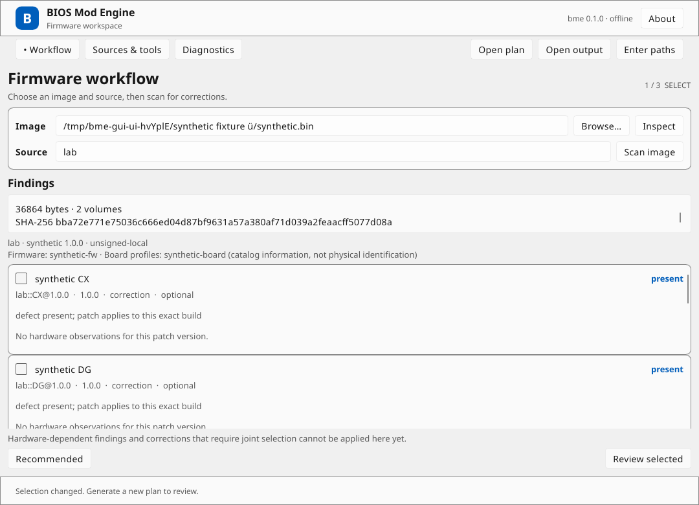
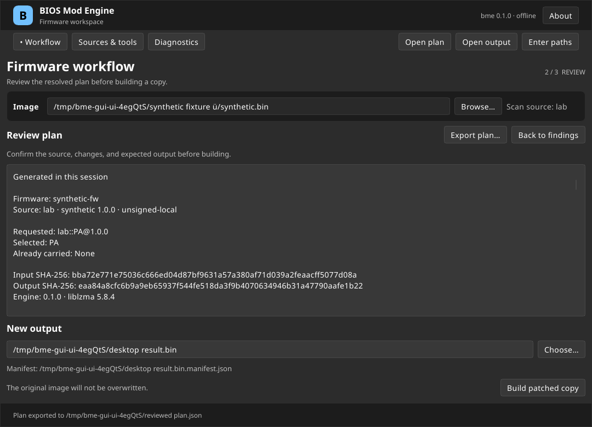

# Desktop interface on Linux

`bme-gui` is a desktop client for `bme`. It reads firmware images and creates new output files; it does not access flash chips. Verification checks the image offline and does not establish boot safety, physical board compatibility or acceptance by platform signature enforcement.

## Build and run

Linux x86_64 is the first GUI target. The GUI requires Rust 1.92 or newer; core and CLI retain their Rust 1.88 minimum. Build both executables together:

```sh
cargo build --locked --release -p biosmod-cli -p biosmod-gui
target/release/bme-gui
```

The GUI looks for `bme` beside its executable. To use another installation, choose it under **Sources & tools**, or launch `bme-gui --engine /absolute/path/to/bme`. An override must pass the protocol handshake and advertise `desktop_workflow: 1`; an older binary with the same package version is insufficient. No engine is loaded from an image or catalog directory.

The build uses Slint 1.18.1 with the winit backend and GPU and software renderers. The GUI links fontconfig, FreeType, libgcc and glibc. The desktop also needs fonts, XKB, and Wayland or X11 client libraries; GPU rendering additionally needs a working OpenGL/EGL stack. Some windowing and graphics libraries are loaded dynamically. Native file dialogs use the XDG desktop portal and a portal backend. Manual path entry remains available if the portal is unavailable. To force software rendering, run:

```sh
SLINT_BACKEND=winit-software target/release/bme-gui
```

CI targets Ubuntu 24.04 x86_64 (glibc 2.39) for the archive and exercises separate X11 and headless Wayland connections. A clean-install test and manual GNOME, KDE Plasma, scaling and screen-reader qualification are still needed before claiming those environments are supported. Track the remaining desktop checks in [#8](https://github.com/juliopolycarpo/biosmod-engine/issues/8). Windows and macOS GUI behavior is not yet qualified.

## Linux archive

Build on the intended Ubuntu 24.04 baseline to avoid requiring a newer glibc:

```sh
./packaging/linux/archive.sh
```

The archive in `dist/` contains the matched binaries, a desktop entry, an icon and license notices. Extract it and run `bin/bme-gui`, or copy its `bin/` and `share/` directories into `~/.local/` and ensure `~/.local/bin` is on `PATH`. The archive is not a sandbox and shares the CLI's configuration, cache and catalog sources. The system still supplies graphics, font, keyboard and portal libraries.

The project's code is MIT. The desktop distribution uses the Slint Royalty-free Desktop, Mobile, and Web Applications License 2.0; **About** displays the required AboutSlint widget. The archive contains that license and the collected runtime dependency notices under `share/licenses/biosmod-engine/`.

## Inspect, plan and verify

1. Choose an image or enter its path, then inspect it. Choose a catalog source and scan. A board profile identifies catalog information, not the revision or components of a physical board.
2. Select independently plannable corrections or use **Recommended** to ask the engine for its recommendation. Rows needing hardware assertions, a hold or diagnostic policy, or joint prerequisite selection cannot be selected in this workflow. A missing detection does not prove a defect is absent.
3. Generate and review the plan, including source pin, input and expected output digests, selected patches, component offsets, policy flags and notes. Changing an input invalidates the review.
4. Choose a new output path and build the patched copy. The paired `<output>.manifest.json` path is shown before publication. Existing files are not overwritten. A publication failure may leave artifacts; inspect the reported paths instead of deleting them automatically.
5. The GUI independently verifies the output using the input, reviewed plan and manifest. It reports completion only when all required checks succeed. An incomplete verification is not a verified result; address the reported missing prerequisites and retry.

Imported plans can be reviewed and used for verification, but cannot be applied. Only a plan generated and reviewed in the current session can build an image. The GUI checks the retained plan bytes before application; `bme` independently revalidates the input, catalog pin, selection and rebuilt output.

Use **Export plan** to keep the exact reviewed document after closing the window. Export requires a new file and preserves the current approval. To reopen a result, choose its original image, saved plan and output; **Open plan**, **Open output** and **Enter paths** remain available throughout the workflow. The output's manifest must be beside it at `<output>.manifest.json`. Imported plans and outputs can be opened in any order; changing their original image clears previous verification and requires another check.

Catalog and tool status are read-only in the GUI. Use the CLI to register or update catalogs and to manage external analysis tools. Source trust is configured by the CLI, not by the catalog being opened.

Light and dark views of the synthetic workflow:





## Settings and diagnostics

The default theme follows the desktop and falls back to light. **Sources & tools** also offers explicit light and dark choices. Theme and engine-path preferences are stored in `$XDG_CONFIG_HOME/biosmod-engine/gui.json`, or `~/.config/biosmod-engine/gui.json` when `XDG_CONFIG_HOME` is unset. Image and output paths are not saved there.

Read-only operations can be cancelled. Building a copy cannot be safely cancelled from the interface; let publication finish. If the process is interrupted externally, check both output paths before trying again. The Diagnostics page can copy or export bounded recent messages. Review those messages for local paths before sharing them.

## Firmware limits

The engine refuses FFS volumes whose image offsets are not eight-byte aligned and refuses reflow when the volume base conflicts with a file's declared alignment. In descriptor images it keeps uncompressed executable files in place because their flash mapping is not established. Different ACPI table offsets sharing one file identity are unsupported for scan and planning. TE relocation coverage checks are explicitly unsupported. These safeguards do not complete the investigations in [#3](https://github.com/juliopolycarpo/biosmod-engine/issues/3), [#5](https://github.com/juliopolycarpo/biosmod-engine/issues/5), [#6](https://github.com/juliopolycarpo/biosmod-engine/issues/6) and [#7](https://github.com/juliopolycarpo/biosmod-engine/issues/7).

When independent verification cannot finish, the CLI reports `VERIFICATION_INCOMPLETE` with the partial report in error details. The GUI keeps incomplete results separate from verified results.

## Validation recorded on 2026-11-09

The real synthetic workflow passed through the controller and through the Slint event loop, including plan export and automatic independent verification. Output bytes and manifest semantics match an equivalent CLI run. Native runs on Ubuntu 26.04/GNOME passed with Wayland software rendering in light and dark themes, Wayland accelerated rendering, and X11 software rendering through XWayland. These are separate from a native Xorg desktop qualification.

Headless callback tests cover enablement, input invalidation, imported plans, publication recovery, cancellation/closure and export. Native AT-SPI inspection found the primary controls and their accessible labels. That check does not establish a complete screen-reader or keyboard-only workflow. Layouts were rendered at 1080×780 and 760×600. Vendor-ROM tests were skipped because no `BME_ROM_*` inputs were configured; no hardware boot test was performed.
