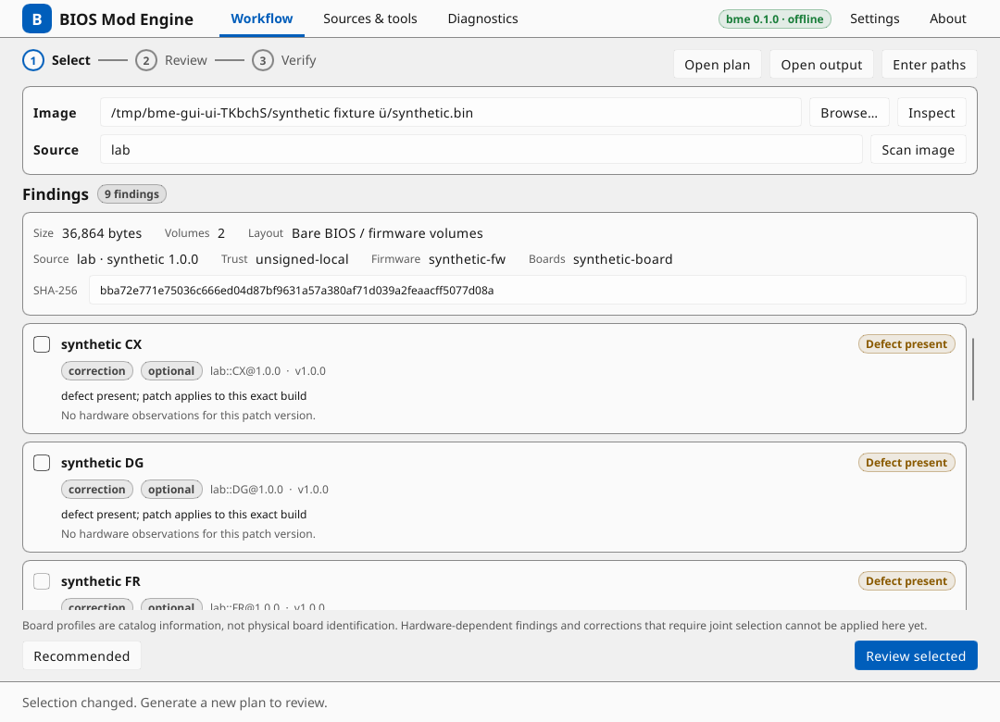
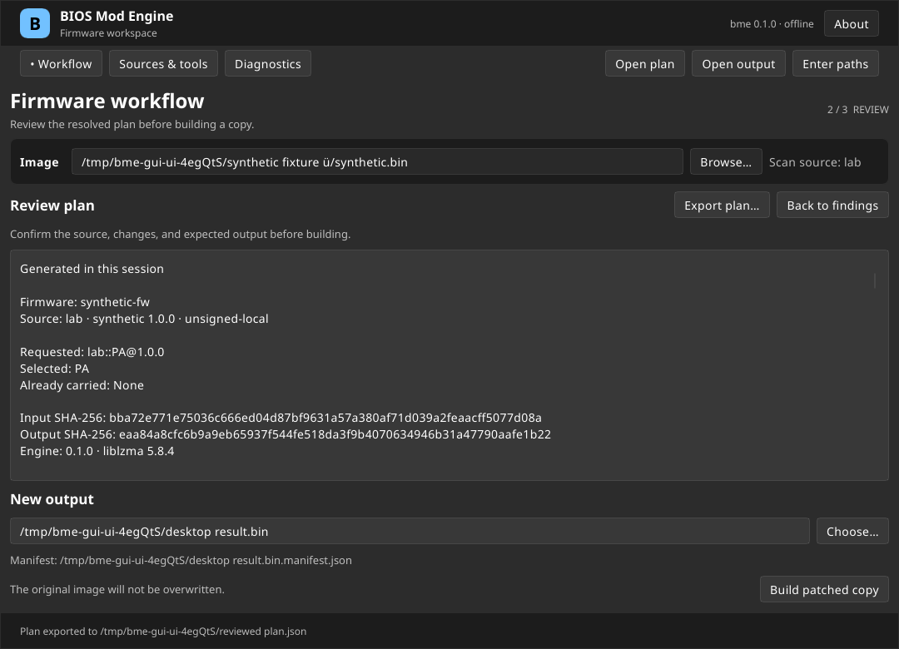

# Interface gráfica no Linux

[English](../../guide/gui.md) | Português (Brasil)

`bme-gui` é um cliente gráfico para `bme`. Ele lê imagens de firmware e cria novos arquivos de saída; não acessa chips flash. A verificação examina a imagem offline e não comprova segurança de inicialização, compatibilidade física com a placa ou aceitação pela verificação de assinatura da plataforma.

## Compilar e executar

Linux x86_64 é o primeiro alvo da interface. A interface exige Rust 1.92 ou posterior; core e CLI mantêm o mínimo Rust 1.88. Compile os dois executáveis juntos:

```sh
cargo build --locked --release -p biosmod-cli -p biosmod-gui
target/release/bme-gui
```

A interface procura `bme` ao lado do próprio executável. Para usar outra instalação, escolha-a em **Configurações** ou inicie `bme-gui --engine /absolute/path/to/bme`. A alternativa deve passar pela negociação de protocolo e anunciar `desktop_workflow: 1`; um executável antigo com a mesma versão do pacote não é suficiente. Nenhum mecanismo é carregado de um diretório de imagem ou catálogo.

A compilação usa Slint 1.18.1 com backend winit e renderizadores de GPU e software. A interface se liga a fontconfig, FreeType, libgcc e glibc. O ambiente gráfico também precisa de fontes, XKB e bibliotecas cliente Wayland ou X11; a renderização por GPU também exige uma pilha OpenGL/EGL funcional. Algumas bibliotecas gráficas e de janelas são carregadas dinamicamente. Os diálogos nativos de arquivo usam o portal XDG do ambiente gráfico e um backend de portal. A entrada manual de caminho permanece disponível se o portal estiver indisponível. Para forçar renderização por software:

```sh
SLINT_BACKEND=winit-software target/release/bme-gui
```

A CI usa Ubuntu 24.04 x86_64 (glibc 2.39) como alvo do pacote e exercita conexões X11 e Wayland sem monitor separadamente. Ainda são necessários teste de instalação limpa e qualificação manual de GNOME, KDE Plasma, escala e leitor de tela antes de declarar suporte a esses ambientes. Acompanhe as verificações restantes em [#8](https://github.com/juliopolycarpo/biosmod-engine/issues/8). O comportamento da interface no Windows e macOS ainda não foi qualificado.

## Pacote Linux

Compile na base Ubuntu 24.04 pretendida para evitar exigir uma glibc mais recente:

```sh
./packaging/linux/archive.sh
```

O pacote em `dist/` contém os executáveis correspondentes, uma entrada de aplicativo, um ícone e avisos de licença. Extraia-o e execute `bin/bme-gui`, ou copie seus diretórios `bin/` e `share/` para `~/.local/` e verifique que `~/.local/bin` está no `PATH`. O pacote não é uma sandbox e compartilha configuração, cache e fontes de catálogo da CLI. O sistema ainda fornece bibliotecas gráficas, de fontes, teclado e portal.

O código do projeto é MIT. A distribuição gráfica usa a Slint Royalty-free Desktop, Mobile, and Web Applications License 2.0; **Sobre** exibe o widget AboutSlint exigido. O pacote contém essa licença e os avisos das dependências de execução em `share/licenses/biosmod-engine/`.

## Inspecionar, planejar e verificar

1. Escolha uma imagem ou informe seu caminho e inspecione-a. Escolha uma fonte de catálogo e analise. Um perfil de placa identifica informações do catálogo, não a revisão ou os componentes de uma placa física.
2. Selecione correções que podem ser planejadas independentemente clicando em um resultado ou pressionando Espaço ou Enter sobre ele, ou use **Recomendados** para solicitar a recomendação do mecanismo. Linhas que exigem afirmações de hardware, uma política hold ou de diagnóstico, ou seleção conjunta de pré-requisitos não podem ser selecionadas nesse fluxo. A ausência de detecção não prova a ausência de um defeito.
3. Gere e revise o plano, incluindo fixação da fonte, hashes da entrada e da saída esperada, patches selecionados, deslocamentos de componentes, flags de política e observações. Alterar uma entrada invalida a revisão.
4. Escolha um novo caminho de saída e gere a cópia modificada. O caminho correspondente `<output>.manifest.json` é mostrado antes da publicação. Arquivos existentes não são sobrescritos. Uma falha de publicação pode deixar artefatos; inspecione os caminhos informados em vez de removê-los automaticamente.
5. A interface verifica a saída independentemente usando a entrada, o plano revisado e o manifesto. Ela informa conclusão somente quando todas as verificações obrigatórias são bem-sucedidas. Uma verificação incompleta não é um resultado verificado; resolva os pré-requisitos ausentes informados e tente novamente.

Planos importados podem ser revisados e usados para verificação, mas não podem ser aplicados. Somente um plano gerado e revisado na sessão atual pode gerar uma imagem. A interface confere os bytes retidos do plano antes da aplicação; `bme` revalida independentemente a entrada, a fixação do catálogo, a seleção e a saída reconstruída.

Use **Exportar plano** para guardar o documento revisado exato depois de fechar a janela. A exportação exige um novo arquivo e preserva a aprovação atual. Para reabrir um resultado, escolha sua imagem original, o plano salvo e a saída; **Abrir plano**, **Abrir saída** e **Informar caminhos** permanecem disponíveis durante o fluxo. O manifesto da saída deve estar ao lado dela em `<output>.manifest.json`. Planos e saídas importados podem ser abertos em qualquer ordem; alterar sua imagem original limpa a verificação anterior e exige outra conferência.

O estado de catálogos e ferramentas é somente leitura na interface. Use a CLI para registrar ou atualizar catálogos e gerenciar ferramentas externas de análise. A confiança da fonte é configurada pela CLI, não pelo catálogo aberto.

Telas em inglês do fluxo sintético, nos temas claro e escuro:





## Configurações e diagnóstico

O tema padrão acompanha o ambiente gráfico e usa o tema claro como alternativa. **Configurações** também oferece opções explícitas clara e escura. O seletor de idioma oferece English (o padrão) e Português (Brasil); as alterações são aplicadas imediatamente e salvas com as demais preferências. O texto do aplicativo segue essa escolha; controles nativos de seleção de arquivo podem seguir o idioma do ambiente gráfico. Diagnósticos do mecanismo e textos do catálogo permanecem no idioma original. As preferências de tema, idioma e caminho do mecanismo são armazenadas em `$BME_CONFIG_HOME/gui.json` quando `BME_CONFIG_HOME` está definido; caso contrário, ficam em `$XDG_CONFIG_HOME/biosmod-engine/gui.json` ou `~/.config/biosmod-engine/gui.json`. Valores vazios e caminhos XDG relativos são ignorados. Valores relativos de `BME_*_HOME` são resolvidos a partir do diretório de inicialização da interface e enviados como caminhos absolutos ao mecanismo. Editar o mecanismo invalida a conexão anterior imediatamente; a preferência é salva ao pressionar Enter ou quando o campo perde o foco. Escolher um executável com Procurar salva imediatamente. Caminhos de imagem e saída não são salvos ali.

Operações somente de leitura podem ser canceladas. A geração de uma cópia não pode ser cancelada com segurança pela interface; aguarde a publicação terminar. Se o processo for interrompido externamente, confira os dois caminhos de saída antes de tentar novamente. A página Diagnóstico pode copiar ou exportar mensagens recentes com tamanho limitado. Revise essas mensagens quanto a caminhos locais antes de compartilhá-las.

## Limites do firmware

O mecanismo alinha arquivos FFS em relação ao volume, permitindo analisar e reorganizar volumes em qualquer deslocamento da imagem. Em imagens com descriptor, endereços flash mapeiam o fim da região BIOS para 4 GiB. Deslocamentos diferentes de tabelas ACPI que compartilham uma identidade de arquivo não são suportados para análise e planejamento. Verificações de cobertura de relocação TE são explicitamente não suportadas. Essas proteções não concluem as investigações em [#5](https://github.com/juliopolycarpo/biosmod-engine/issues/5) e [#6](https://github.com/juliopolycarpo/biosmod-engine/issues/6).

Quando a verificação independente não pode terminar, a CLI informa `VERIFICATION_INCOMPLETE` com o relatório parcial nos detalhes do erro. A interface mantém resultados incompletos separados dos verificados.

## Validação registrada em 2026-11-09

O fluxo sintético real passou pelo controlador e pelo loop de eventos Slint, incluindo exportação de plano e verificação independente automática. Os bytes de saída e a semântica do manifesto correspondem a uma execução equivalente da CLI. Execuções nativas em Ubuntu 26.04/GNOME passaram com renderização por software Wayland nos temas claro e escuro, renderização acelerada Wayland e renderização por software X11 via XWayland. Isso é separado da qualificação de um desktop Xorg nativo.

Testes de callbacks sem monitor cobrem habilitação, invalidação de entrada, planos importados, recuperação de publicação, cancelamento/fechamento e exportação. A inspeção AT-SPI nativa encontrou os controles principais e seus rótulos de acessibilidade. Essa verificação não comprova um fluxo completo com leitor de tela ou somente teclado. Layouts foram renderizados em 1080×780 e 760×600. Após o refinamento da interface, capturas nativas com renderização por software Wayland nos dois tamanhos e temas cobriram todas as páginas no mesmo host Ubuntu 26.04/GNOME; nenhum outro desktop foi verificado novamente. Testes com ROMs de fornecedores foram ignorados porque nenhuma entrada `BME_ROM_*` estava configurada; nenhum teste de inicialização em hardware foi realizado.
